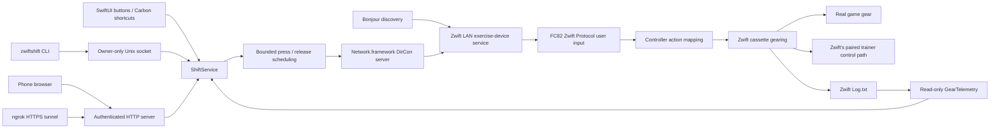

# Architecture

## Chosen control path

The product uses Zwift's native LAN exercise-device pipeline. Commands wait for
the resulting `Gearing: Shift` records; the first experiment also captured the HUD.

The trainer arrow describes Zwift's responsibility. This investigation proved
game-state changes and observed virtual-shifting enablement on the paired KICKR;
it did not measure resistance under pedaling load.

## Local input map of Zwift 1.125.0

| Family | Local evidence | Relationship to shifting |
|---|---|---|
| Keyboard / mouse | Cocoa/GLFW metadata and live synthetic events | UI automation works; no direct keyboard gear binding established |
| Gamepads / HID | IOHIDManager imports, controller database, InputMappingManager | Candidate layer; unprivileged virtual-HID prototype did not register |
| Zwift Click / Play BLE | CoreBluetooth, FC82, user-input component | Discovery, handshake, capabilities, button states; older BLE protocols use encryption |
| Companion devices | Companion TCP and Sensor Relay classes/messages | Alternate transport, not independently implemented |
| LAN devices | Bonjour types, LanExerciseDeviceService, WFTNP logs | **Implemented and live verified through DirCon** |
| Generic shift actions | Action registration strings, packed mappings, callbacks | Maps digital buttons to cassette actions |
| Other local IPC | Process sockets and imports inspected | No ordinary local shift API established; not proof none exists |

The game is mostly stripped C++, with Objective-C Cocoa/GLFW metadata.
`LOC_OPTIONS_BINDING_SHIFTUP` and `LOC_OPTIONS_BINDING_SHIFTDOWN` are localization
clues, not proof of keyboard bindings. No direct GameController.framework import
was found.

## Observed execution path

The game is `~/Library/Application Support/Zwift/ZwiftAppSilicon`, version
**1.125.0 (168455)**, UUID **BEF66B12-36AE-3B61-BAB6-A8FF70F24319**. Addresses below
are diagnostic **offsets from the Mach-O image base** for this exact build.
**None are used by the product.**

1. Bonjour discovery creates a WFTNP/LAN exercise device. FC82 alone was found
   but not selectable; Cycling Power service 1818 enables initial classification.
   The controller never sends fabricated power measurements.
2. TCP service discovery exposes FC82 and characteristics `02` (events), `03`
   (writes from Zwift), and `04` (responses).
3. `RideOn 02 04` → `RideOn 02 00` establishes the observed unencrypted LAN
   session. Device information supplies user-input capabilities.
4. Zwift adds component **23**, requests input configuration **0x400** and battery
   **0x303**, and accepts the device under **Controls**.
5. Opcode **0x23**, protobuf field 1, supplies active-low digital buttons:
   **0x1000 up**, **0x0100 down**. A neutral state follows every press.
6. A bounded observer captured the cassette gearing routine at **0x183b13c**.
   Direction was **0 for up**, **1 for down**, count **1**. Immediate return
   addresses were **0x16c8988** and **0x16c8aa4**. The common observed stack was
   **0x16c6648 → 0x16c5b88 → 0xdaf354 → 0x1886f78 → 0x1d0db30 → 0x1d2a1d8 →
   0xc74c80**.
7. Zwift logged `Gearing: Shift 0-(8 -> 9)` and the reverse; its HUD showed those
   gears. The first successful test had **no debugger attached**.

Names for stripped functions are interpretations of strings, surrounding code,
and live arguments. The separately identified `gameplay_ztap_*` callbacks were
not hit by this controller; the observed path uses cassette actions. The bounded
read-only observer is `Experiments/instrumentation/trace_shifts.js`.

## Native code boundaries

| Component | Responsibility |
|---|---|
| `WireProtocol`, `DirConSession` | Pure bounded framing, protobuf, services, handshake/subscriptions |
| `NetworkBackend` | Bonjour/TCP, same-Mac peers, neutral keepalive, fresh sessions |
| `ButtonPulse`, `ShiftService` | Pulses, counts, hold limits, cancellation, confirmation |
| `GearTelemetry` | Bounded read-only log tail, partial lines, rotation, dynamic dimensions |
| `LocalRPC` | Current-user IPC, exclusive ownership, resource limits |
| `PhoneHTTP`, `PhoneRouter` | Bounded HTTP, private-link authentication, expiry/replay checks, bundled web assets |
| `PhoneControl`, `NgrokTunnel` | Server lifecycle, local URLs, optional ngrok worker and shutdown |
| `ZwiftShiftApp` | SwiftUI, Carbon shortcuts, settings, lifecycle |
| `zwiftshift` | Argument parsing and RPC; shared-core foreground service |

Mutable service/UI state uses the main actor with Swift 6 concurrency checking.
Network callbacks run on the main queue; network I/O and timers do not block it.
Blocking CLI socket I/O runs only in the separate CLI process.

The phone endpoint calls `ShiftService.shift` with a single press. It has no
separate DirCon/protocol implementation. Browser holds serialize confirmed
requests; the server never retains a remotely held button. The browser's
observed gear still comes from `GearTelemetry`. The HTTP server is distinct from
the same-Mac-only DirCon endpoint; ngrok forwards only the phone port.

## Lifecycle and failure behavior

- Persisted generated identity; fresh handshake/subscriptions for every TCP
  connection. Zwift initiates reconnects. No unbounded retry loops.
- Maximum four network clients and eight RPC peers. TCP payloads are at most
  4096 bytes, decoder buffers are bounded, RPC input is at most 8 KiB.
- Service ownership uses `flock`; socket mode 0600 inside a 0700 directory;
  peer UID must match the current user.
- Concurrent shifts are rejected. Counts are limited to 100, holds to 30 seconds.
- Monotonic deadlines and bounded latency-critical activity assertions keep
  requested shifts responsive while Zwift is in front; system sleep stays allowed.
- Cancellation, disconnect, settings changes, sleep, and quit release buttons.
  Mouse holds also end on app deactivation. Quick taps complete a minimum pulse.
- Four-second neutral keepalive does not interrupt an active pulse. Normal quit
  permits pending release writes to flush.
- Gear count comes from Zwift, never a fixed 24. Historical feedback is labeled
  observed; only fresh matching transitions confirm commands.
- Logs rotate at 1 MiB with one previous file. UI memory retains 100 events.
- Phone requests have 8 KiB headers and 2 KiB bodies, 24 concurrent connections,
  bounded deadlines, an 8-action/second rate limit, and a bounded replay cache.
  Fresh commands expire within five seconds; the browser requests two seconds.
- The app starts its HTTP listener automatically. Internet access is persisted;
  ngrok startup has a 25-second deadline and explicit retry. The small CLI worker
  owns ngrok and observes a pipe from the app. EOF or parent exit shuts down and
  reaps ngrok, including after an app crash.

The undocumented protocol is version-sensitive. Changed handshakes or log formats
can fail confirmation; the app never substitutes a fabricated gear.
