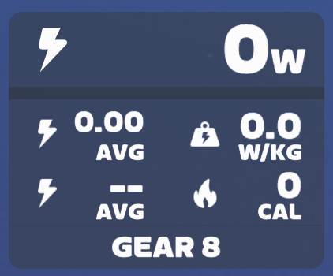
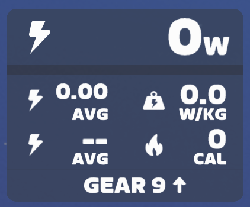
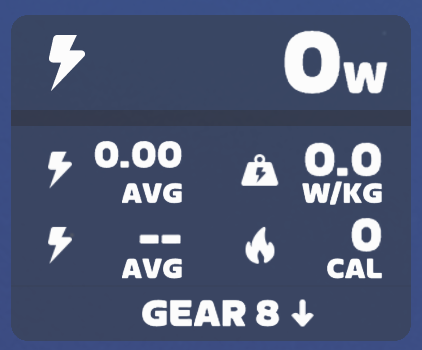

# Acceptance evidence — 2026-11-09

## What was actually verified

**Zwift's own gear changed without a physical shifting controller.** Tests used
Zwift **1.125.0 (168455)** on Apple silicon / macOS **27.2 (26B123)**. The native
app is built with Swift **6.4.2**. The installed game binary SHA-256 is recorded
in `RESEARCH.md`; instrumentation is not required by the product.

Initial tests had the saved KICKR CORE selected for power, cadence, and
resistance, and the software device under Controls. Power/distance stayed zero.
The user later clarified that the KICKR was unavailable at the current location;
subsequent campus tests explicitly verify software/game behavior only.
**No test here measures trainer resistance under pedaling load.**

## First decisive HUD sequence

| Action | Zwift's observed gear | Game-log time (CST) |
|---|---:|---|
| Baseline | 8 | Before upshift |
| Software up press/release | 9 | 10:33:56 |
| Software down press/release | 8 | 10:34:03 |





These are **unaltered HUD crops** of actual Zwift-window captures; only cropping
removed unrelated rider/chat information. Full originals remain in private,
ignored `LocalEvidence/raw/`. The initial proof used the research LAN prototype
with no debugger attached. The subsequent native implementation was tested
separately, as below.

```text
[10:33:56] INFO LEVEL: [Connectivity] Gearing: Shift 0-(8 -> 9)
[10:34:03] INFO LEVEL: [Connectivity] Gearing: Shift 0-(9 -> 8)
```

## Native app and CLI live checks

| Test | Observed result | Evidence scope |
|---|---|---|
| Native CLI up | 8 → 9 at 10:51:24 | Fresh game-log confirmation |
| Native CLI down | 16 → 15 at 10:51:59 | Fresh game-log confirmation |
| CLI up `--count 5` | 15 → 20 at 10:51:59–10:52:01 | Five matching changes; game capture retained |
| CLI down `--count 5` | 20 → 15 at 10:53:05–07 | Five matching changes |
| Mouse taps | 15 → 16 → 15 at 10:56:25–28 | One change each |
| Mouse holds, 1.2 s | 15 → 19 → 15 at 10:56:31–37 | Four changes per hold; stable after release |
| Game restart / network move | Controller rediscovered and re-paired at 11:20:51 | Trainer unavailable; bootstrap repeated |
| Campus CLI up/down | 8 → 9 → 8 at 11:21:14–23 | Actual game log, not physical resistance |
| Global shortcut taps | 9 → 10 → 9 at 11:25:01–04 | One change each |
| Global shortcut holds, 1.2 s | 9 → 13 → 9 at 11:25:06–10 | Four each; no changes after release |
| Optimized app restart | New handshake at 11:26:53–54 | Reconnected to the already-running game |
| Release CLI symmetric batches | 9 → 10 → 9 → 14 → 9 | Independently checked fresh log lines |
| Final release, eight CLI/shortcut cases | 13 → 14 → 13 → 18 → 13; taps and holds return to 13 | All eight cases pass in one run |
| Custom 600 ms interval, 1.55 s holds | 13 → 16 → 13 | Three changes each; idle after release |
| Custom Control–Option–Shift arrows | 13 → 14 → 13 | One change each; defaults restored |

Input acceptance is independent of the app's own display: tests read new Zwift
log lines. `sentPresses` and `observedChanges` are distinct counters. Successful
socket writes do not count as gear confirmation.

Machine-readable, reviewed evidence is in [Evidence/](Evidence/), including the
final release run, original isolated mouse/shortcut tests, custom controls,
reconnection, and the unit/integration test transcript.

Two later combined GUI runs overlapped extra system-source mouse clicks. A
bounded event trace observed additional PID-0 down/up pairs after the test
utility's pairs. Those runs are **not recorded as exact-count passes**. Earlier
isolated tap/hold runs passed. The live script intentionally fails on unexpected
extra changes rather than suppressing them.

## Automated unit and local integration checks

**18 tests passed**. They cover CLI validation; malformed/fragmented/coalesced
DirCon frames; protobuf bounds; captured handshake/capability/battery/button
fixtures; subscriptions and fresh reconnect state; no fabricated power; dynamic
gear dimensions; shortcut/settings validation; real Unix RPC, exclusive ownership,
permissions and restart; log split lines and rotation; minimum pulse timing,
cancellation and transport-error release; real TCP handshake, notification
delivery, malformed-session close, and successful reconnect.

These tests are not claimed as live Zwift validation. TCP tests use ephemeral
ports with Bonjour advertising disabled, so they do not add test devices to the
running game. Focused Ruff and ShellCheck checks are also run on the research and
build utilities.

## Reproduce

```sh
swift test
Scripts/build.sh
open build/ZwiftShift.app
# Pair the controller, enter a free ride, choose a gear away from both limits:
python3 Scripts/live_acceptance.py --live
```

Use `--desktop-tests --screenshots` for bounded app clicks and shortcut holds.
Keep the dashboard at its default size and close sheets. Do not use other
controls while exact-count checks run. Evidence goes under `build/live-*`; the
script stops on failure with no blind retry. Screenshots are private by default.

## Practical limits

- Verified for this installed Zwift build and macOS/architecture, not every
  historical/future version or every trainer.
- Trainer load response, sustained riding, ERG behavior, and sleep/wake with the
  physical trainer remain future ride checks.
- The app may require Power Source bootstrap discovery after a fresh Zwift start.
  Restore the actual trainer for power/resistance/cadence afterward.
- Feedback is from the local game log; simultaneous other inputs can make
  attribution ambiguous. The HUD proof is independent visual evidence.
- macOS scheduling is not hard real time; configured repeat intervals are a
  cadence target, with bounded holds and explicit release cleanup.

Configuration backup/restoration and the final installation state are recorded
in the closing research entry. Original backups remain local and ignored.

All original configuration files were first restored with matching hashes; final
setup then retained only the verified software Controls selection and cache entry.
The saved KICKR Power, Resistance, and Cadence selections match the original
preferences. The installed game binary hash is unchanged. Zwift exited normally;
the native app remains available for the next ride.
