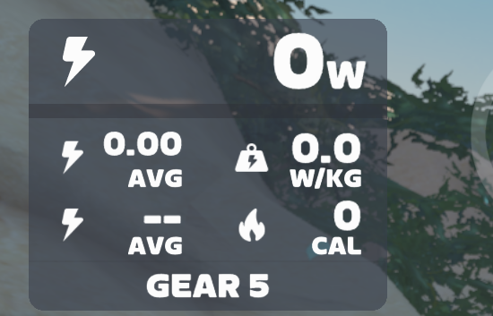

# KICKR connected but reporting zero watts

Investigation on **2026-11-09**, America/Chicago. **Not yet a verified repair.**
The user reported that pedaling their KICKR CORE 2 did not produce watts in
Zwift. Earlier shifting acceptance was stationary, so it did not establish
working power measurements or trainer load while riding.

## Direct observations

- Zwift 1.125.0 selected **KICKR CORE CED4**, firmware **3.5.24**, over Bluetooth
  for Power Source, Resistance, and Cadence. The software controller was under
  Controls. Saved preferences agreed. The virtual controller sends no power.
- After the user said they would begin pedaling, five captures at
  **14:59:15–14:59:28 CST** still showed **0 watts** on the actual KICKR card.
  These captures do not independently prove when the physical flywheel moved.
- Refreshing Power Source alone left other roles connected to the same BLE
  peripheral. A full reconnect therefore unpaired all KICKR roles, with the
  final physical BLE disconnect logged at **15:03:13**.
- The actual KICKR was then reselected, with a fresh connection and characteristic
  subscriptions. Zwift logged protocol communication established at **15:03:48**.
  Power, Resistance, Cadence, and the previously selected heart-rate bridge were
  restored. The software Controls pairing remained. No shift commands were sent
  during this investigation; the game stayed at gear **5**.
- A bounded, read-only Frida observer watched **Zwift's existing BLE callback**
  for 20 seconds. It did not create another connection, change subscriptions,
  write a characteristic, patch game state, or send a shift. It unloaded and
  detached afterward.
- The KICKR delivered new Cycling Power (`2A63`), FTMS Indoor Bike Data (`2AD2`),
  and Zwift Protocol notifications throughout the capture. Ten sampled Cycling
  Power values at **15:04:24–15:04:42** decoded to **0 watts**. FTMS also carried
  zero speed, cadence, and power. The sampled Cycling Power wheel/crank counters
  were unchanged. This is explicit zero data, not absence of packets.
- A new pedaling confirmation after the reconnect was requested. It is pending
  at this record's creation. Do not label this later capture as a confirmed
  pedaling test or assert a hardware defect from stationary zero measurements.

The game also logged an unknown-device-type capability warning while talking to
the KICKR. That warning's causal relevance is **not established**; the physical
power notifications above arrived independently. Do not change device identity,
trainer firmware, or protocol behavior merely to suppress it.

Reviewed evidence: [sampled power values and detach result](Evidence/kickr-zero-power.json).
The following is an unaltered crop of the game HUD after reconnect, showing
zero watts and the unchanged gear. It is not a successful riding test.



## Reproducible observation

Discover the current Zwift PID with executable-name-only process inspection.
Never print full process arguments; Zwift's launch arguments can include account
credentials. Then, in an appropriate debugging session:

```sh
.venv/bin/python Experiments/instrumentation/observe.py \
  --pid CURRENT_PID \
  --script Experiments/instrumentation/trace_trainer_values.js \
  --seconds 20 > build/kickr-values.jsonl
```

The observer targets the previously inspected
`_TtC14ble_middleware17SwiftBLEInterface` callback and fails if that class/method
is absent. It filters KICKR CORE peripherals, samples selected characteristics
at most once per second, and retains bounded byte prefixes. It is an isolated
diagnostic tool, not a product dependency. Use the existing experiment environment
documented in [Experiments](../Experiments/README.md).

Private originals: `build/power-live-samples/`,
`build/kickr-values-after-reconnect.jsonl`, and `build/kickr-*.png`. Before the
pairing refresh, the three existing configuration XMLs were backed up with hashes
under `LocalEvidence/backups/power-repair-20261109-145750/`. All pairing changes
used Zwift's UI; the installed binary and macOS security settings were preserved.

## Next decisive checks

1. Coordinate a fresh 15-second pedaling interval with the user and compare
   trainer notifications and the game's watts. Zero while stationary is expected.
2. If the flywheel is turning and fresh packets still report zero, close other
   trainer-controlling apps on nearby devices and power-cycle the KICKR by
   unplugging it for **30–35 seconds**. This requires a physical action the agent
   cannot perform. Recheck the actual KICKR roles afterward.
3. If it still sends zeros, compare the same physical pedaling in the Wahoo app
   and check firmware using Wahoo's supported workflow. Do not infer that a
   firmware update is required or perform one without a concrete reason.

Steps 2–3 follow [Wahoo's connected-but-no-data troubleshooting](https://support.wahoofitness.com/hc/en-us/articles/115000502070-KICKR-is-connected-but-no-speed-cadence-or-power-data),
read on this date. They are proposed checks, not completed actions or a promised
fix. The current software-only reconnect is complete; a successful watts/riding
test is still required before reporting this issue resolved.
