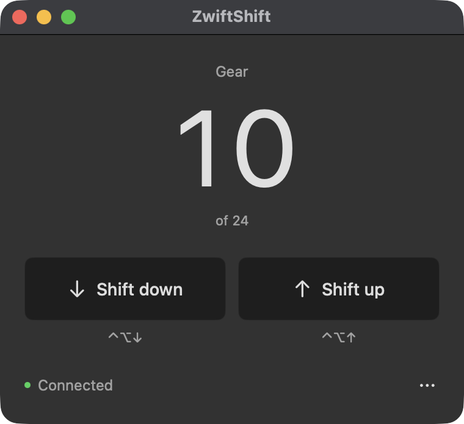

# ZwiftShift

A native macOS controller for Zwift virtual shifting. Click, hold a button, use
a global shortcut, open the phone controls, or run `zwiftshift up`.
No physical Zwift Click is required.

**For the next AI agent:** start with [HANDOFF.md](HANDOFF.md). It consolidates
the findings, verified state, protocol details, pitfalls, and remaining work.
Repository guidance in [AGENTS.md](AGENTS.md) points agents there automatically.

**Actual game integration is verified on Zwift 1.125.0 (168455), Apple silicon,
macOS 27.2.** The first live test changed the Zwift HUD **8 → 9 → 8**. The native
app, counted CLI shifts, mouse holds, and keyboard holds produced matching gear
transitions in Zwift's own log. The final home check passed **12 live cases with
the KICKR CORE connected and virtual shifting enabled throughout**. See
[test evidence](Documentation/ACCEPTANCE.md). These were stationary tests;
trainer resistance under pedaling load has not been measured.



## Launch on this Mac

Open **`~/Desktop/ZwiftShift.app`**. The installed CLI is
**`~/.local/bin/zwiftshift`**, already on this Mac's PATH.

```sh
open ~/Desktop/ZwiftShift.app
zwiftshift status
zwiftshift up
zwiftshift down
zwiftshift up --count 5
```

The app and CLI are built from this directory. The installed entries are symlinks;
keep the project in place, or uninstall the links before moving it, then rebuild
and reinstall. No background daemon or login item is installed.

## Pair with Zwift

1. Start ZwiftShift, then open Zwift's **Paired Devices** screen. In a ride,
   pressing **A** opens pairing.
2. Find **ZwiftShift Input** under **Controls**. A fresh clone uses **ZwiftShift**.
3. If absent, temporarily select that name under **Power Source**. Wait a few
   seconds for Zwift to read its capabilities, then select it under **Controls**.
   You may need this discovery step again after restarting Zwift.
4. Set **Power Source**, **Resistance**, and **Cadence** back to your actual KICKR
   CORE. Leave **Controls** on ZwiftShift Input. The software controller supplies
   no power measurements.
5. Enter a free ride with virtual shifting enabled in Zwift. Shift up and down
   and check Zwift's gear display.

When the trainer is unavailable, the software controller can still connect and
Zwift can process gear changes. Physical resistance requires the real trainer.
ERG workouts and supported trainer firmware remain Zwift's responsibility.

The app includes this guide. **Connected** means Zwift accepted the controller;
the gear number comes from Zwift's log. It is never an optimistic counter.
Missing feedback is shown as **—**.

## Controls

- **Shift up:** Control–Option–↑. **Shift down:** Control–Option–↓.
- Hold a button or shortcut to repeat. Release stops repetition. Holds have a
  30-second ceiling; release and press again to continue.
- Open **… → Settings** or press **Command–,** to change shortcuts and repeat
  timing: **200–2000 ms**, default **350 ms**. This also sets timing between
  counted CLI shifts. Existing personal settings are preserved.
- Shortcuts register only while the controller is connected and paired. Ordinary
  arrow keys remain available. Conflicts are reported in settings.

The compact window follows the Mac's light/dark appearance. **… → Activity**
opens the live event log; click the connection status for pairing details.

## Phone controls

Launching the app also starts its small web server. Click the URL beneath the
connection status, or choose **… → Phone controls**, then scan the QR code on your
phone. **Copy private link** includes the access key; copying the displayed base
address alone does not authorize shifting. The page has the observed gear and
two buttons; hold either to repeat at your configured interval.

The local link works on the same network. Turn on **Internet access via ngrok**
in that panel to use the HTTPS link from another network, including cellular.
Ngrok is installed and authenticated on this Mac; the app uses its existing
configuration without changing it. Internet access is a persisted preference.
Keep ZwiftShift and Zwift running on the Mac. The public address may change after
relaunch; use the current QR/link. A free ngrok account may show **Visit Site**
before the controls open.

Only people with the private link can read ride status or shift. **Reset links**
revokes previously copied links. Quitting the app stops its server and tunnel.
See [phone setup and HTTP interface](Documentation/PHONE_CONTROLS.md) for other
machines, connection errors, test scope, and protocol details.

If Zwift says **“You currently don't have a smart trainer paired,”** connect a
compatible trainer for **Power Source** and **Resistance**. Keep ZwiftShift under
**Controls**. Use the pairing picker's **All** filter if the KICKR is missing from
Recommended. The app shows **Select your trainer** if the software controller
was left under Power Source, and **Trainer not ready** if Zwift has not enabled
virtual shifting. Game gear feedback alone does not establish trainer readiness.
See [Zwift's virtual-shifting requirements](https://support.zwift.com/virtual-shifting-faq-r16UiRFlT).

## CLI

```sh
zwiftshift status
zwiftshift up
zwiftshift down --count 3
zwiftshift up --count 5 --json
zwiftshift diagnostics
zwiftshift --help
```

Counts must be **1–100**. Commands wait for fresh gear-change lines from Zwift.
Exit codes: `0` confirmed/success; `1` usage or service error; `2` rejected or
unconfirmed shift. Reaching a gear limit can produce an unconfirmed result; there
are no blind retries. Avoid other controls during exact counted verification.

For a foreground service without the UI:

```sh
zwiftshift serve
# In another terminal:
zwiftshift up
```

Only one app/service may run at once. `serve` shares the complete backend and
protocol with the app. Global shortcuts are provided by the desktop app.
Ctrl-C stops `serve` and releases any held button.

## Build from source

Requires macOS 14 or newer, a Swift 6 toolchain with the macOS SDK, and Apple's
command-line developer tools. Only macOS 27.2 / Swift 6.4.2 / arm64 has been tested.
The native app and CLI have **no third-party package dependencies**. Internet
phone access optionally runs the separately installed ngrok executable.

Quit ZwiftShift before rebuilding so the app and CLI run the same version.

```sh
cd ~/Desktop/zwiftshit
Scripts/build.sh            # optimized app + CLI; ad hoc local signing
Scripts/install.sh          # symlinks on ~/Desktop and in ~/.local/bin
Scripts/run.sh
```

`Scripts/build.sh --debug` builds debug artifacts. Both interfaces use
`ZwiftShiftCore`; protocol serialization exists in one place. The native icon is
generated reproducibly by `Scripts/make_icon.swift`.

Allow normal macOS **Local Network** access if prompted. Desktop access is needed
for this project location; Documents access permits read-only gear feedback from
`~/Documents/Zwift/Logs/Log.txt`. The app's Carbon shortcuts require no Accessibility
event interception. Optional UI test tools need post-event permission; screenshot
tests need Screen Recording. Setup does not disable security protections.

## Verify

```sh
swift test
node --test Tests/phone-controls.test.mjs
python3 Scripts/live_acceptance.py --live
python3 Scripts/live_acceptance.py --live --shortcut-tests
# Require real trainer virtual shifting to stay enabled for every case:
python3 Scripts/live_acceptance.py --live --require-trainer --desktop-tests --screenshots
# Optional full UI/shortcut test, with the main dashboard open:
python3 Scripts/live_acceptance.py --live --desktop-tests --screenshots
```

Unit and local integration tests cover framing, captured protocol examples,
parsing, dynamic gear state, cancellation, timing, real Unix RPC, real TCP
negotiation, malformed frames, reconnect, and log rotation. They do not claim to
validate Zwift and do not advertise fake controllers to the game. Phone tests
also cover HTTP framing, authentication, replay/expiry checks, a real HTTP
listener, and browser hold/release scheduling.

The explicit `--live` script changes actual game gears and checks fresh Zwift log
lines independently of CLI responses. It returns to the starting gear on success.
Start at least five gears from each end, close settings sheets, and avoid manual
controls while it runs. Desktop tests expect default shortcuts and use the
buttons' accessibility identifiers, independent of window position. Accessibility
access is required for that test helper. Evidence goes under `build/live-*`.
Screenshots may contain rider names;
review them before sharing.

## How it works

Zwift's local-network exercise-device implementation accepts a DirCon service
advertised over Bonjour. The app supplies a minimal Zwift Protocol user-input
component, completes the observed handshake, and sends button press/release
notifications. Zwift dispatches these to its cassette-shift actions. Your trainer
remains paired directly to Zwift.

The product uses no Bluetooth loopback, driver, debugger, patched game, Zwift
account token, or Zwift server API. The DirCon listener accepts only this Mac's
addresses; the CLI socket is restricted to the current user. Phone controls use
a separate authenticated HTTP listener and the same shared shifting service.

- [Architecture and execution path](ARCHITECTURE.md)
- [Wire protocol](Documentation/PROTOCOL.md)
- [Local CLI/app interface](Documentation/LOCAL_INTERFACE.md)
- [Phone controls and HTTP interface](Documentation/PHONE_CONTROLS.md)
- [Research notebook](RESEARCH.md) and [approach comparison](FINDINGS.md)
- [Test evidence and limits](Documentation/ACCEPTANCE.md)
- [Public research references](Documentation/REFERENCES.md)
- [Minimal interface and design references](Documentation/UI.md)
- [Remaining work](ROADMAP.md)

## Settings, troubleshooting, and removal

Runtime state lives in **`build/runtime/`**: `settings.json`, private `phone.json`,
owner-only `control.sock`, `service.lock`, and bounded `events.jsonl` logs. Device identity is
generated once and persisted. `ZWIFTSHIFT_HOME` overrides this directory for both
app and CLI; use the same value for both.

If discovery fails, repeat the Power Source bootstrap and restore the trainer
afterward. Keep an active network interface; discovery was verified before and
after moving networks. For unconfirmed shifts, check the ride, gear limits,
trainer settings, and Documents permission. `zwiftshift diagnostics` provides a
bounded history without reading credentials. A future Zwift update may require
protocol changes; unknown handshake versions fail explicitly.

For **Connected but 0 watts**, first check that Power Source is the actual KICKR.
The software controller never supplies power. A Connected label and a changing
gear do not prove the trainer is measuring your pedaling. The current diagnostic
record is [KICKR power investigation](Documentation/KICKR_POWER.md); its unresolved
checks must not be reported as successful riding tests.

```sh
# Quit ZwiftShift, then remove only this project's installed symlinks:
Scripts/uninstall.sh
```

Unpair ZwiftShift in Zwift if desired. Uninstall preserves source, runtime settings,
and original configuration backups in `LocalEvidence/backups/`. No system driver
or daemon needs removal. The installed Zwift binary is unchanged. See the
acceptance record for configuration restoration after research.

MIT license for this original implementation. ZwiftShift is an independent
personal project, not an official Zwift product.
